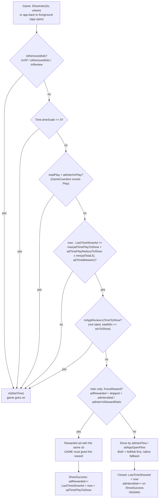
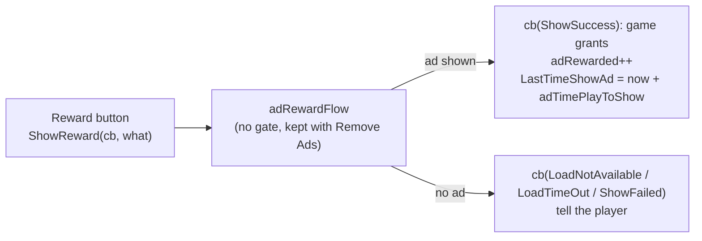

# Ads, Remove Ads and IAP in Base: how it works and how a game uses it

For AI agents and developers of every game built on Base. Read this before designing, tuning or coding anything about
ads, Remove Ads, VIP or IAP rewards: most rules a design asks for **already exist** as an `AdConfig` key or a Base flow.
Written from the code of com.zen.core (2026-10-31): `Runtime/Ads/Scripts/` (`AdConfig`, `AdConfigRemote`,
`AdsManager`, `AdBase`, `AdmobInter`, `AdmobReward`, `AdmobAppOpen`, `AdmobBanner`, `AdZative`, `AdSplash`,
`InAppReview`, `RemoveAdsButton`, `ButtonWatchAdToGetCurrency`), `Runtime/IAP/` (`IAPButtonExtent`, `IAPManager`,
`RestorePurchasesButton`, `IAPSettings`) and `Runtime/DataManager/` (`DataManager`, `UserDataBase`, `GameConfig`). When code
and this file disagree, the code wins: report it, fix this file.

## 1. The pieces

| Piece | Lives in | Role |
|---|---|---|
| `AdsManager` | `ADsManager` prefab (DontDestroyOnLoad, splash scene) | Static API: `ShowInter`, `ShowReward`, `IsTimeToShowAds`, `IsRemovedAds`, `ForceReward`, `LoadAds`. |
| Placements (`AdBase`: `AdmobInter`, `AdmobReward`, `AdmobAppOpen`, `AdmobBanner`, `AdZative`) | children of `ADsManager` | One ad unit each (`PlacementType`). `AdZative` = native ads (Android waterfall). |
| `AdConfig` | `Assets/Resources/AdConfig.asset` (Base > Hub > Setup) | Timing and flow settings (section 3). |
| `AdConfigRemote` | static | Copies Remote Config keys into `AdConfig` after each fetch. |
| `AdSplash` | splash scene | UMP consent, ads init, preload, FTUE interstitial, then the game scene. |
| `UserData` (`UserDataBase`) | save file (`DataManager`) | Flags `isRemovedAds`, `isVIP`; counters (section 5); events `OnRemovedAdsChanged`, `OnVIPChanged`. |
| `DataManager.InReview` | `DataManager` | True when Remote Config `bundleVersion` < this build's `bundleVersion` (store review build): ads off. |
| `IAPButtonExtent` + `IAPManager` (com.zen.iap, `USE_IN_APP_PURCHASE`) | shop buttons, `IAPManager` prefab | Buy a product and grant its `rewards` list (section 6). |
| `RemoveAdsButton` (`AdBannerRemoveADs` prefab) | inside banner / MREC frames | "Remove ADs" button, turned into the Remove Ads purchase. |
| `ButtonWatchAdToGetCurrency` | game UI | Ready-made "watch an ad for coins" button: rule 4.4, reward `SoftCurrencyByReward`, locked while the ad runs, optional `cooldownMinutes` and `maxPerDay`. |

## 2. Value order

Remote Config (applied by `AdConfigRemote` after a fetch) over the game's `AdConfig.asset` over the defaults written in
`AdConfig.cs`. **Never rename or remove a key**: live Remote Config projects use them.

## 3. `AdConfig` keys (all are Remote Config keys of the same name)

| Key | Type | Default | What the code really does |
|---|---|---|---|
| `adTimePlayToShow` | float s | 15 | Base gap between two interstitials / app opens (4.1). Also how long an interstitial is held **after a rewarded ad** (`AdmobReward`: `LastTimeShowAd = now + adTimePlayToShow`). |
| `adTimePlayReduceToShow` | float s | 15 | Added to the gap **per successful ad**, up to 5 ads: `adTimePlayToShow + this × min(adTotal, 5)`. Despite the name, the positive default makes the gap **grow** 15 → 90 s; a negative value shrinks it. |
| `adTimeBetween` | float s | 6.8 | Floor of that gap: `max(formula, adTimeBetween)`. |
| `adLoadTimeout` | float s | 6.8 | How long a load may take before giving up (rewarded loading toast: × 2.5). |
| `adInterOnPlay` | int | 0 | No interstitial / app open while `UserData.totalPlay < adInterOnPlay`: the "no ads before game N" rule. Base counts `totalPlay` from `GameState.Play` (`GameCounters`, section 5). |
| `adInterOnStart` | bool | true | Flag **for the game**: show an interstitial when a game starts. Base never reads it. |
| `adInterOnComplete` | bool | true | Flag **for the game**: show an interstitial when a game ends. Base never reads it. |
| `adInterOnFTUE` | int | 1 | `AdSplash`: interstitials shown on the splash at app start (count in PlayerPrefs `isShowInterstitial`); 0 = none. A per-game choice, tuned remotely. |
| `adMrecOnFTUE` | int | 1 | Defined and remote, read by no Base code (for the game). |
| `adInterVsRewardRatio` | int 1–20 | 5 | "Surprise reward": when `adRewarded + adRewardSkipped < adInterstitial / N`, the next `ShowInter` shows a **rewarded ad instead** (`ForceReward`); ≤ 0 = off. **Base grants nothing**: the `ShowInter` callback receives `type Reward / RewardInter` + `ShowSuccess` and the game must reward the player, otherwise set 0. |
| `adInterFlow` | `AdFlow` | Both | Interstitial source (FTUE too): `OnlyNative = 0` (AdZative), `OnlyDefault = 1` (AdMob), `Both = 2` (AdMob first, native when AdMob has none). |
| `adRewardFlow` | `AdFlow` | Both | Rewarded source, same values. |
| `adAppOpenFlow` | `AdFlow` | OnlyNative | App open source. |
| `adBannerFlow` | `AdFlow` | OnlyNative | Banner source. |
| `adBannerReload` | int s | 30 | Banner swaps to a new ad after each impression; never below 30 s (AdMob guideline, clamped). |
| `adBannerOffset` | int dp | 10 | Gap above the native banner. |
| `adCtrMin` | float 0–1 | 0.1 | Native full-screen: player CTR on the unit at or below this ⇒ ✕ / Next locked a little longer (`AdCtr`). |
| `adCtrMax` | float 0–1 | 0.35 | Native full-screen: CTR above this after a click ⇒ on return, the next ad of the pod or close. |
| `forceMediaScaleMeta` | bool | false | Native media: ON = Fit (Meta forbids cropping), OFF = Center Crop. |
| `taichi_config_json` | JSON | "" | `TaichiManager` settings. |
| `<native placement name>` (e.g. `AdZative_Inter_Default`) | JSON | | Per-placement native settings (`AdZative.ApplyRemoteConfig`). |

Asset only (no remote key): `rewardByAd` 500, `rewardLevelScale` 0.05 ⇒ `AdsManager.SoftCurrencyByReward =
clamp(rewardByAd × (1 + adTotal × rewardLevelScale), rewardByAd, 5 × rewardByAd)`; `rewardLevel` is unused.

## 4. AdsManager rules

### 4.1 `IsTimeToShowAds`: the gate for interstitials and app opens (never for rewarded)

In order; the first `false` stops:
1. `ForceAds` (debug, Test All Ads) ⇒ always true.
2. `Time.timeScale <= 0` ⇒ false (game paused).
3. `IsRemovedAds` ⇒ false: `UserData.isVIP` or `UserData.isRemovedAds` or `DataManager.InReview`.
4. `totalPlay < adInterOnPlay` ⇒ false.
5. Seconds since `LastTimeShowAd` ≥ `max(adTimePlayToShow + adTimePlayReduceToShow × min(adTotal, 5), adTimeBetween)`.
6. `InAppReview.isTimeToShow` (not rated yet and `totalWin ≥ winToShow`) ⇒ false: that moment goes to the rating popup.

### 4.2 What resets `LastTimeShowAd`

| Event | New value |
|---|---|
| App start (`AdsManager.Start`) | now: no interstitial right after the splash |
| Interstitial / app open closed (`AdBase`) | now |
| Rewarded granted (`AdmobReward`) | now + `adTimePlayToShow` |
| Purchase started (`AdsManager.DelayAdsForPurchase`, from `IAPButtonExtent`) | now + 60 s (nothing over the store sheet) |
| `ShowInter(..., forceShow: true)` | 1 hour back (skips the gap only, not steps 2–4) |

### 4.3 Calls

- `ShowInter(callback, "where")`: Removed Ads ⇒ `NotTime`; gate 4.1 ⇒ `NotTime`; `ForceReward` ⇒ a ready rewarded ad
  with **this callback**; else by `adInterFlow`. **The callback always runs** (also on `NotTime`): continue the game
  in it, never wait for an ad.
- `ShowReward(callback, "what")`: no gate, not blocked by Remove Ads / VIP (the player chose it); by `adRewardFlow`.
  Reward only on `state == ShowSuccess`. No ad ⇒ `LoadNotAvailable` / `LoadTimeOut` / `ShowFailed`: tell the player.
- App open: on each return to the foreground, through gate 4.1 and `adAppOpenFlow`; skipped after
  `SuppressNextAppOpen("why")` (e.g. the player was sent to the store to rate) or while a full-screen ad shows. Banner /
  MREC hide while it shows. App opens count with interstitials (`adInterstitial`).

### 4.4 Rewarded button: UI rule

- **The button is always shown.** Do not hide or disable it by ad availability and never use `CheckAvailable` for a
  rewarded button: the ad is loaded when it is asked for (best show rate and match rate). Base preloads only the AdMob
  rewarded once at init (`LoadAds`, adRewardFlow OnlyDefault / Both); after that, and for the native rewarded, the load
  happens on `ShowReward`.
- On tap: `AdsManager.ShowReward(callback, "placement")` with the default `ShowLoadingMode.Toast`. Base shows the
  loading toast and tells the player when there is no ad ("Ad load FAILED...", "Ad show FAILED..."): the game adds no
  loading or message of its own.
- The game only: sets the button non-interactable from the tap until the callback (no double tap); grants the reward
  only on `ShowSuccess`; on any other state grants nothing and makes the button tappable again.
- The button is hidden only when the game (or a future monetization layer) decides not to offer a reward there.

## 5. UserData: what Base counts and what the game must count

| Field | Updated by | Used by |
|---|---|---|
| `isRemovedAds`, `isVIP` | `IAPManager.TryGrant`, `IAPManager.RestorePurchases`, debug panels | `IsRemovedAds`, banners (events) |
| `adInterstitial` (interstitial + app open), `adRewarded`, `adBanner` | `AdBase` on `ShowSuccess` | `adTotal`, `ForceReward`, milestones `ad_*_N_times` |
| `adRewardSkipped` | `AdsManager` (ForceReward had no ad) | `ForceReward` |
| `adTotal` = `adInterstitial + adRewarded` | computed | gap formula, `SoftCurrencyByReward` |
| `lifeTimeValue` | `AdBase` ad revenue (`ad_impression`) | analytics, `TaichiManager` |
| `currentLevel`, `totalTimePlay`, `session` | **the game** | analytics |
| `loginDay` | `UserData.Init` (once per calendar day) | analytics |
| `totalPlay`, `totalWin`, `totalLose`, `winStreak` / `loseStreak` | `GameCounters` from `GameStateManager` (`Play` not after Pause / Revive, `Win`, `Lose`); off with `GameCounters.IsEnabled = false` for a game that counts itself | `adInterOnPlay` (`totalPlay`), `InAppReview` (`totalWin`), analytics |

Every setter sends a user property (`total_play`, `ad_total`, `is_removed_ads`...). Changes are saved with the save file
(`DataManager.Save`). Read UserData only after `DataManager.IsLoaded` / `OnLoaded`.

## 6. IAP: rewards, Remove Ads, VIP

1. Tap on an `IAPButtonExtent`: `AdsManager.DelayAdsForPurchase()` (interstitials held 60 s), log `IAP Click`.
2. The store answers `OnPurchasePending` ⇒ `IAPManager.TryGrant(button)` walks the button's **`rewards` list**:
   - `CurrencyType.Ad` ⇒ `UserData.isRemovedAds = true`;
   - `CurrencyType.VIP` ⇒ `UserData.isVIP = true`;
   - `Soft` / `Hard` ⇒ `CurrencyManager.GrantFromPurchase` (fly FX);
   - anything else (Booster, Skin, Item...) ⇒ `IAPManager.OnGrantReward(button, reward)`: the game grants it.
3. `DataManager.Save` **before** `ConfirmPurchase`; data not loaded ⇒ not confirmed, the store delivers again. Log
   `IAP Success` / `Failed`.

Packs can live as data: the `IAPPackDatas` asset (in `DataManager.itemDatas`, `IAPPackData { productId, rewards
(List<Reward>), badge, icon, isOffer }`) and an `IAPButtonExtent` takes the rewards of the pack with its `productId` from
it (`IAPManager.GetPack(id)`); Booster / Item rewards with an id are then granted by `Rewards.Grant`. A button without
a pack keeps its own `rewards` list. UI sample: `Datas/IAPPackDatas`, shop `UIPopupIAP` (it sets `CurrencyManager.OpenShop`), game-end interstitial in `GameEndAd`.

So **any pack removes ads by having a reward line `Ad`** (the default `IAPButtonExtent` is 5000 Soft + `Ad`): a Starter
Pack, a gem pack or a bundle needs no new code or flag. A pack without `Ad` only holds interstitials for 60 s.
`RemoveAdsButton` (in `AdBannerRemoveADs`, on any button such as the Settings one) becomes the Remove Ads purchase
(`IAPSettings` product id, reward `Ad`); it hides without Unity IAP and once ads are removed. `RestorePurchasesButton`
(iOS, Settings) calls `IAPManager.RestorePurchases`, which sets `isRemovedAds` when the store holds a purchase.

### 6.1 When `isRemovedAds` or `isVIP` becomes true

`UserDataBase` raises `OnRemovedAdsChanged` / `OnVIPChanged`; at once:
- `AdmobBanner`: `rootRectTransform.offsetMin = 0` (the game UI it had pushed up goes back down), reload stopped, banner
  destroyed, placeholder hidden.
- `AdZative` (every native placement **except rewarded**): banner offset back to 0, ad destroyed, `SetActive(false)`.
- `AdsManager.IsRemovedAds` is true: `ShowInter` ⇒ `NotTime`, no app open, `LoadAds` skips the interstitial,
  `AdBase.isCanLoad` refuses every type but rewarded, `ReloadAd` stops, `AdSplash` skips the FTUE interstitial.
- Rewarded **still works** through AdMob. `adRewardFlow`: `Both` = AdMob rewarded first, the native rewarded
  (`AdZativeRewardDefault`) only as fallback when AdMob has no ad; `OnlyNative` = the native rewarded **replaces** the
  AdMob one; `OnlyDefault` = AdMob only. Remove Ads / VIP keep **both** rewarded placements: `AdZative.OnRemoveAdChanged`
  skips `Reward` / `RewardInter` (fixed 2026-10-31; before, it deactivated `AdZative_Reward_Default` too, so a Remove Ads
  player lost the fallback with `Both` and every rewarded ad with `OnlyNative`). After Remove Ads, `AdBase.ReloadAd` no
  longer preloads after a show, so a rewarded ad loads when the button is tapped (a loading toast, a little longer).

## 7. End-to-end flow

### 7.1 Interstitial and app open: the decision



### 7.2 Rewarded



### 7.3 Purchase, Remove Ads, VIP

```mermaid
sequenceDiagram
    participant P as Player
    participant B as IAPButtonExtent
    participant S as Store (Unity IAP)
    participant M as IAPManager.TryGrant
    participant U as UserData
    participant A as Ads (AdsManager, banners)
    P->>B: tap
    B->>A: AdsManager.DelayAdsForPurchase: LastTimeShowAd = now + 60 s
    B->>S: PurchaseProduct(productId)
    S-->>B: OnPurchasePending
    B->>M: TryGrant(rewards)
    M->>U: Ad ⇒ isRemovedAds = true / VIP ⇒ isVIP = true
    M->>U: Soft / Hard ⇒ CurrencyManager.GrantFromPurchase
    M-->>P: other types ⇒ IAPManager.OnGrantReward (game)
    U-->>A: OnRemovedAdsChanged / OnVIPChanged
    A->>A: banners: rootRectTransform.offsetMin = 0, destroy, hide; AdZative (not rewarded) SetActive(false)
    A->>A: IsRemovedAds: no inter, no app open, no FTUE; rewarded (AdMob + native) kept
    B->>B: DataManager.Save, then ConfirmPurchase
```

### 7.4 Whole session

```text
Splash (AdSplash): UMP → AdsManager.IEInit → LoadAds (inter if !IsRemovedAds, rewarded)
                 → FTUE interstitial (adInterOnFTUE, adInterFlow) → game scene      [LastTimeShowAd = now]
Game:  GameState Play / Win / Lose → GameCounters: totalPlay / totalWin / totalLose ++ → ShowInter("where") if adInterOnStart / OnComplete
                 → gate 4.1 → (ForceReward ⇒ rewarded) → adInterFlow → close  [LastTimeShowAd = now]
       reward button → ShowReward("what") → ShowSuccess ⇒ game grants         [LastTimeShowAd = now + adTimePlayToShow]
       back from background → app open (gate 4.1, adAppOpenFlow)
       banner (adBannerFlow): loaded ⇒ rootRectTransform.offsetMin.y = banner height, reload ≥ adBannerReload
Shop:  IAPButtonExtent → purchase started (inter held 60 s) → TryGrant(rewards) → Save → Confirm
       reward Ad / VIP ⇒ OnRemovedAdsChanged / OnVIPChanged ⇒ banners gone, UI back, inter / app open off, rewarded kept
```

## 8. What a game does (checklist)

- Drive the game through `GameStateManager` (`Play` once per game, then one `Win` or `Lose`): `GameCounters` then
  counts `totalPlay` / `totalWin` / `totalLose` for `adInterOnPlay` and `InAppReview`. Count `currentLevel`,
  `totalTimePlay`, `session` yourself.
- Call `AdsManager.ShowInter(cb, "where")` at its own moments, honouring `adInterOnStart` / `adInterOnComplete`; go on
  in the callback.
- If `adInterVsRewardRatio > 0`: in that callback, reward the player when `type` is `Reward` / `RewardInter` and
  `state == ShowSuccess`. Otherwise set the key to 0.
- Rewarded buttons (4.4): always shown, `ShowReward` with the default Toast mode, non-interactable until the callback,
  grant only on `ShowSuccess` (or use `ButtonWatchAdToGetCurrency`).
- Banner games: put the game's root UI rects in the banner placement's `rootRectTransform` (game's `ADsManager`
  variant) so the UI sits above the banner and comes back when ads are removed.
- Shop: one `IAPButtonExtent` per product; add `Ad` (and / or `VIP`) to `rewards` of every pack that should remove
  ads; grant the other types in `IAPManager.OnGrantReward`.
- Tune pacing in Remote Config with the keys of section 3; never hard-code timings in the game.

## 9. Before you propose something new

| Design asks for | Already there |
|---|---|
| No interstitial before game N | `adInterOnPlay = N` (`GameCounters` counts `totalPlay`) |
| Interstitial at app start on / off | `adInterOnFTUE` |
| Longer gaps for heavy ad watchers | positive `adTimePlayReduceToShow` (default) |
| No interstitial right after a rewarded | built in (`adTimePlayToShow` hold) |
| Swap some interstitials for rewarded | `adInterVsRewardRatio` (game grants the reward) |
| Paying player sees no ads | reward `Ad` / `VIP` on the pack (6) |
| "Remove ADs" on the banner | `AdBannerRemoveADs` + `RemoveAdsButton` |
| No ads during store review | `InReview` via Remote Config `bundleVersion` |
| No ad over the store sheet | 60 s hold on purchase start |
| Ad source A/B (AdMob vs native) | `ad*Flow` keys |

Not in Base today (propose first, in a plan): a cap of interstitials per session or per day, a cooldown after returning
to the app, skipping an interstitial after a losing streak, pacing by player segment. Hook them into
`IsTimeToShowAds` (one place, applies to interstitial and app open) rather than around each `ShowInter` call.
