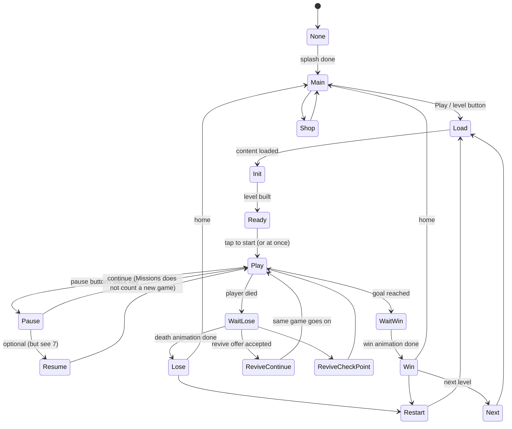

# GameStateManager in Base: the states, who listens, how a game drives its UI with it

Read from the code (2026-10-31): `zen-base/Base/GameStateManager.cs`, `GameStateListener.cs` (built into
`Plugins/Base.dll`, namespace `Base`) and every listener in `com.zen.core/Runtime`. Read this before designing a game
flow, popups or a feature that reacts to "a game started / ended". Code wins over this page.

## 1. The pieces

| Piece | Where | Job |
|---|---|---|
| `GameStateManager` | `Runtime/Extensions/GameStateManager.prefab`, in the first (splash) scene, `DontDestroyOnLoad` | One global state: `CurrentState`, `Last`, `OnGameStateChanged`. A second copy destroys itself. |
| `GameState` | enum in Base.dll | The states (2). |
| `GameStateListener` | component | Inspector-only reaction to one state (`UnityEvent onStateChanged`). |
| The game | its screens, popups, gameplay | **Calls the setters** at the right moments and shows its UI from the event. Base never changes the state by itself. |

## 2. API

```csharp
public enum GameState { None, Main, Load, Init, Ready, Play, Pause, ReviveContinue, ReviveCheckPoint, WaitLose, Lose,
                        WaitWin, Win, Restart, Next, Shop, Tutorial, Resume, Quit, ReOpen, PassByAd, Other = 999 }

GameState GameStateManager.CurrentState   // None while the prefab is missing
GameState GameStateManager.Last
event StateDelegate OnGameStateChanged    // (GameState current, GameState last, object data)

// static setters; each throws "GameStateManager could not find ..." when the prefab is not in the scene
Main(bool force = false, object data = null)   Load(data)   Init(data)   Ready(data)   Play(data)   Pause()
Restart(data)   Revive(bool isCheckpoint = false, object data = null)   WaitLose(data)   Lose(data)
WaitWin(data)   Win(data)   Resume(data)   Next(data)   Shop(data)   Quit(data)   Other(data)
```

The enum values are implicit (`None = 0` … `PassByAd = 20`, `Other = 999`): never insert or reorder a state, a
saved or serialized value (Inspector field of `GameStateListener`, analytics) would change meaning.

`Tutorial`, `ReOpen` and `PassByAd` exist in the enum but have **no setter**: a game cannot enter them today.

## 3. Rules of the event

- The event fires only when the state **changes**. Calling `Play()` while in `Play` does nothing (no event).
- `Main(force: true)` sets `None` then `Main`: **two** events (`None` from the old state, then `Main` from `None`), so
  listeners of `Main` run again even when the state already was `Main`.
- `data` is stored on the manager and passed with the event. `Pause()` takes no data and does **not** clear it: the
  `Pause` event carries the data of the previous setter.
- Every change logs `StateChanged: last --> current`.
- `GameStateManager` does not touch `Time.timeScale`. Pausing the game logic is the game's job; note that
  `AdsManager.IsTimeToShowAds` is false while `Time.timeScale <= 0` (no interstitial during a pause).
- Order: listeners run in subscription order, synchronously, inside the setter call.

## 4. Intended flow



A casual game without loading steps can go `Main → Play → Lose / Win → Main` (the UI sample goes through every state:
`Main → Load → Init → Ready → Play → WaitWin → Win / WaitLose → Lose → Main`). Keep `WaitLose` / `WaitWin` when there is an end animation: the result UI listens to `Lose` / `Win`, gameplay
input stops at `WaitLose` / `WaitWin`.

## 5. Who listens in Base

| Listener | Reacts to | Does |
|---|---|---|
| `Missions` (daily missions, achievements) | `Play` with `last` not `Pause` / `ReviveContinue` / `ReviveCheckPoint`; `Win`; `Lose` | `Report("play")`, `Report("win")`, `Report("lose")`. A revive or a resume is the same game; `Restart → … → Play` and `Lose → Play` count a new one |
| `CurrencyManager` | `Main`, `Restart`, `Next`, `Init` | resets `SoftEarned` / `HardEarned` (earned this game); on `Main` / `Init` re-counts the coin / gem labels from 0 |
| `InAppReview` | any change **leaving** `Win` (`last == Win`) | `CheckToShow`: review popup when not rated and `totalWin ≥ winToShow` |
| `AdmobBanner`, `AdZative` banners | `Main`, `Play`, `Resume`, `Lose`, `Win` (and back from background) | reload a banner that failed or never loaded |
| `WeatherFX` | `Play`, `Resume` | random weather effect |
| `AdBase`, `AdmobAppOpen`, `FirebaseManager` (IAP log) | `CurrentState` read, not the event | the state name is the ad / purchase placement when the call gives none |
| `FirebaseManager.LogLevel(state, ...)` | the game passes a state | logs `level_<state>` (`level_play`, `level_win`...); `Play` also sets `UserData.currentLevel` |

**Not listening in com.zen.core code**: `UIManager`, `UIScreen`, `UIPopupBase<T>`, `AdsManager`, `DataManager`,
`DailyLogin`, `NotificationManager`. The game's UI is what maps states to screens (6): in a game, `Main()` means "show the
main screen", so call it only when the player really goes home, never to "reset" a state.

## 6. Driving the UI from the state (the game's part)

One place maps states to UI, usually the game's screen manager or each screen / popup subscribing in `OnEnable` and
unsubscribing in `OnDisable`:

| State | Usual UI | Base parts that fit |
|---|---|---|
| `Main` | home screen; daily login, missions, achievements dots; tapped reminder route | `DailyLogin.CanClaim`, `NotificationManager.TakeRoute()` |
| `Load` / `Init` | loading screen | |
| `Ready` | "tap to start" | |
| `Play` | in-game HUD, pause button | |
| `Pause` | pause popup (`UIPopupBase<T>`), `Time.timeScale = 0` by the game | |
| `WaitLose` | input off; **revive offer** (rewarded or gems) ⇒ `Revive()`, else `Lose(result)` | `AdsManager.ShowReward`; UI sample: `GameFlow.Lose` + `UIPopupRevive` |
| `WaitWin` | input off, end animation | |
| `Lose` | game over popup (the game is lost: `GameCounters` / Missions count it) | never revive after `Lose`: that game would count as lost twice |
| `Win` | result popup, then interstitial if `adInterOnComplete` | `AdsManager.ShowInter(cb, "win")`; leaving `Win` triggers the review check |
| `Shop` | shop screen | `IAPButtonExtent` |

Rules:
- `GameCounters` (Base) counts games from the states: `Play` not after `Pause` / `Revive*` ⇒ `totalPlay++`, `Win` ⇒
  `totalWin++` and `winStreak++`, `Lose` ⇒ `totalLose++` and `loseStreak++` (`adInterOnPlay`, `InAppReview`, analytics
  read them). So raise exactly one `Win` or `Lose` per game. A game that counts by itself sets
  `GameCounters.IsEnabled = false` before the first game. `currentLevel` stays the game's.
- Show the interstitial **after** the result UI at the end of a game (`adInterOnComplete`), never when a level opens
  (`adInterOnStart = false`, Google Play policy).
- Never open home popups (daily login, a tapped reminder's route, offers) over gameplay: not while `Play` (nor
  `Pause`, `WaitLose` / `WaitWin`, `Revive*`). A route that arrives during a game waits for its end. Do **not** call
  `Main()` just to unlock them: `Main` shows the main screen.
- Use `Pause` / `Play` for pausing so Missions does not count a second game; use `Revive` (not `Play` from `Lose`
  directly) for a revive, or the revive counts as a new game.
- Use the state names the game really goes through: `Missions` only knows `Play`, `Win`, `Lose`.

## 7. Pitfalls found in the code

- Calling a setter without the prefab in the scene throws (by design: a clear message instead of a silent failure).
  Every scene that can be the first one (splash, a test scene opened directly) needs the prefab.
- `Lose → Play` counts a new game (`Missions`); a revive done with `Play()` instead of `Revive()` is counted twice.
- `Pause → Resume → Play` also counts a new game: `Missions` only skips `last == Pause` / `Revive*`. Go back with
  `Play()` straight from `Pause`, or do not pass through `Resume` before `Play`.
- `Pause` keeps the previous `data`.
- `Main(force: true)` raises `None` first: a listener that treats `None` as "game start" runs.
- A tapped reminder's route waits while `Play` (the UI sample's home opens it when it shows again).

## 8. Before you propose something new

| Design asks for | Already there |
|---|---|
| "A game started / won / lost" for missions, achievements | `Missions` listens (5) |
| Reset coins earned this game | `CurrencyManager` on `Main` / `Restart` / `Next` / `Init` |
| Review popup after a win | `InAppReview` on leaving `Win` |
| A one-off reaction in a prefab without code | `GameStateListener` |
| Level analytics with the state | `FirebaseManager.LogLevel(state, ...)` |

Not in Base: a state for tutorial / reopen / pass-by-ad (enum only, no setter), a UI router that opens screens by
state, a pause that sets `Time.timeScale`. Propose first, in a plan.
