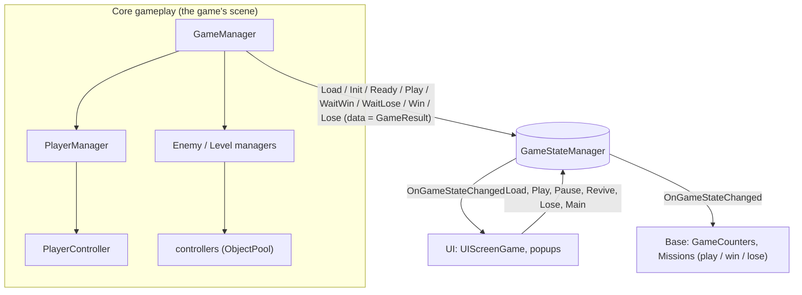

# Gameplay on Base: GameManager → managers → controllers, and who listens to the game states

For AI agents and developers starting a game on Base. The **UI sample** (Package Manager > Base > Samples > UI, scene
`99_SampleScene`, its `README.md`) is the reference for the flow and the UI: every GameState, the home, the in-game
screen and the popups, with a stand-in `GameFlow` instead of gameplay. Read with [GameState.md](GameState.md) (the
states), [Ads.md](Ads.md) (ads, Remove Ads, IAP) and Architecture.md section 11 (daily login, missions,
achievements, rewards). Code wins over this page.

## 1. The rule

**GameManager drives the core gameplay only.** It never opens UI, shows an ad or sells anything. It tells
`GameStateManager` what happened (with the level / race result as `data`); UI and monetization listen to
`OnGameStateChanged` and do their part, and answer through `GameStateManager` too. Nobody calls GameManager. In the UI
sample `GameFlow` plays this part (debug buttons instead of gameplay).

- **One direction**: GameManager → its managers → their controllers. A controller only moves and raises C# events; a
  manager owns its controllers (spawn, pool, tick); GameManager decides the game state. No calls between siblings.
- **No new singletons**: GameManager is a scene component holding `[SerializeField]` references to its managers.
  Base managers stay static (`AdsManager`, `DataManager`, `UIManager`, `CurrencyManager`, `SoundManager`,
  `MusicManager`, `Missions`...).
- **One update loop**: GameManager's `Update` ticks the managers while the game runs; controllers have no `Update`,
  so pausing is one flag.
- **Pools** for anything spawned again and again (`UnityEngine.Pool.ObjectPool<T>`, `collectionCheck`, `maxSize`);
  **tuning in a ScriptableObject**; no allocation per frame (texts change only when their value does).

## 2. The states of one game (UI sample)

| Who sets it | State | Who listens, what they do |
|---|---|---|
| Home (Play) | `Load` → `Init` → `Ready` | GameFlow shows `UIScreenGame`, loads, builds; the screen counts 3-2-1 |
| `UIScreenGame` after the countdown | `Play` | gameplay runs; Base `GameCounters` (`totalPlay++`) and Missions (`play`) |
| HUD pause / back key | `Pause` ↔ `Play` | `UIPopupPause`; back to `Play` directly (not through `Resume`: not a new game) |
| GameManager (goal) | `WaitWin(result)` → `Win(result)` | controls hidden during the end animation; `UIPopupResult` |
| GameManager (failed) | `WaitLose(result)` | controls hidden; GameFlow: revive offer (`UIPopupRevive`, rewarded) while `result.revivesLeft > 0`, else `Lose` |
| Revive popup (ad watched) | `ReviveContinue` | GameManager clears the danger, then `Play` next frame (not a new game) |
| Revive popup (skipped) | `Lose(result)` | after the game-end interstitial; Base: `totalLose++`, Missions `lose`; `UIPopupResult` |
| Result popup (closed) | `Main` | after the game-end interstitial; home |
| Debug / result buttons | `Next` / `Restart` → `Load` | the next or the same level |

**Revive at `WaitLose`, never after `Lose`**: `GameCounters` and `Missions` count every `Lose` as a lost game. A
second listener calling a setter inside an event (`Play` from `ReviveContinue`, `Lose` from `WaitLose`) does it on the
next frame, so every listener of the first state sees it first.

## 3. Reporting events (missions, achievements) during play

One line where the event happens: `Missions.Report("overtake")`. Base adds it to today's daily missions and the
lifetime achievement counters, saves when one completes, and raises `Missions.OnCompleted(mission, isAchievement)`.
Report discrete events as they happen and totals at the end. Keep the game's keys in one class of constants.
`play` / `win` / `lose` / `watch_ad` / `earn_soft` / `unlock_item` are reported by Base (the UI sample uses only these).

## 4. Monetization

The game offers the revive at `WaitLose` (the UI sample: `GameFlow.Lose` opens `UIPopupRevive`). The interstitial of a game end is shown by the popup that ends the game
(`GameEndAd`: a skipped revive, a closed result) when `AdConfig.adInterOnComplete` is on; `AdsManager` decides if it is
time. IAP packs are the `IAPPackDatas` asset (in the Splash's `DataManager.itemDatas`): an `IAPButtonExtent` takes the
rewards of the pack with its `productId`, `IAPManager.TryGrant` grants them. The shop is the game's popup
(`CurrencyManager.OpenShop`; the sample's `UIPopupIAP`). Ad pacing stays with `AdConfig` / Remote Config ([Ads.md](Ads.md)).

## 5. A new game

1. Base > Hub > Setup: **Create** the Splash (Build Settings index 0), **Add** the game's ItemDatas to its
   DataManager. The game's scene is index 1; Base > Play From Splash starts every Play at the Splash.
2. Import the UI sample, copy what fits (screens, popups, `GameFlow` as the skeleton of GameManager, `GameResult`).
3. Write GameManager → managers → controllers; it only talks to `GameStateManager`.
4. Keep revive at `WaitLose`, one `Win` or `Lose` per game, and reward buttons always shown (Ads.md 4.4).
